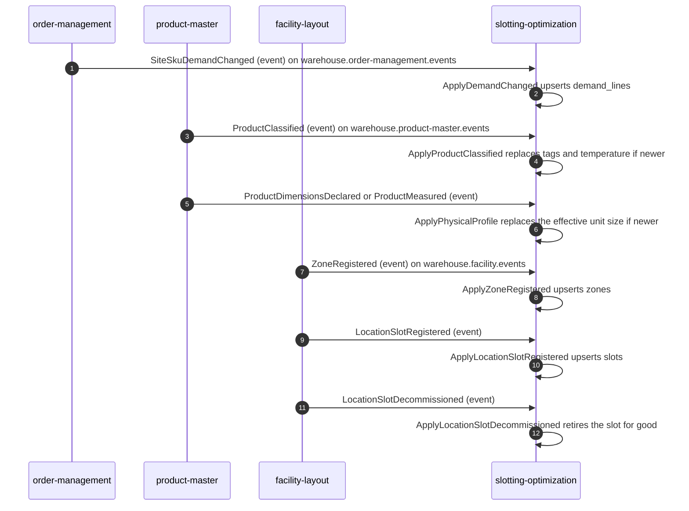
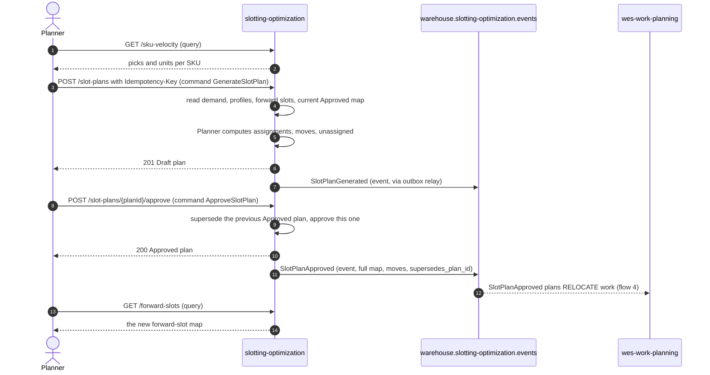
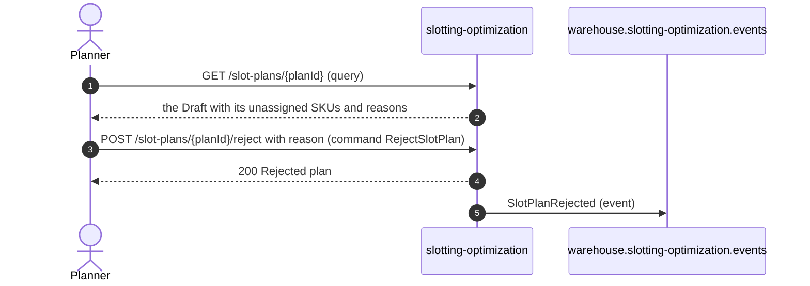
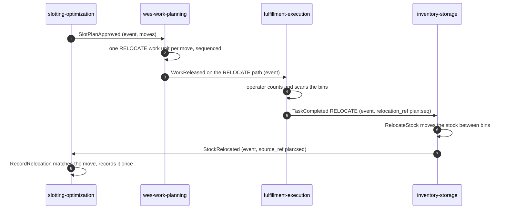
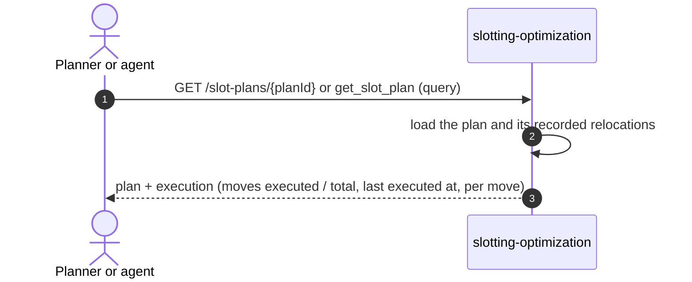

# Domain message flow

The key business scenarios as numbered command / event / query flows,
following ddd-crew
[Domain Message Flow Modelling](https://github.com/ddd-crew/domain-message-flow-modelling).
Messages are labelled *(command)*, *(event)* or *(query)*. Only edges that
exist in code are solid.

## 1. Keep the local copies current

Source: `internal/adapters/inbound/kafka/{demand,product,layout}_consumer.go`,
`internal/application/usecases/consumers.go`.

## 2. Generate a plan and approve it

Source: `internal/application/usecases/generate_plan.go`,
`internal/application/usecases/decide_plan.go`,
`internal/adapters/outbound/outbox/relay.go`.

## 3. Reject a plan

Source: `internal/application/usecases/decide_plan.go` (`RejectPlan`).

## 4. Execute the moves and record the progress

Decided by [ADR 0010](/docs/adr/0010-approved-slot-plans-are-executed-as-wes-relocation-work)
(supersedes [ADR 0007](/docs/adr/0007-executing-an-approved-slot-plan)).
The middle of the flow lives in the sibling contexts; this context publishes
the plan and reads back what the ledger recorded.

Source here: `internal/adapters/inbound/kafka/stock_consumer.go`,
`internal/application/usecases/record_relocation.go`,
`internal/domain/slotplan/execution.go`. The other steps are
wes-work-planning ADR 0040, fulfillment-execution ADR 0047 and
inventory-storage ADR 0039.

## 5. Read the execution progress

Source: `internal/application/usecases/queries.go` (`GetPlan.View`).
