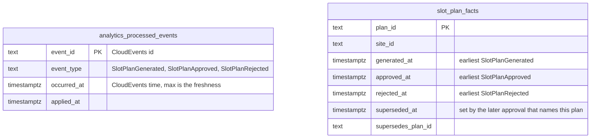

# Entity-relationship diagram

The OLTP schema (migrations `0001`-`0003`) created by the migrations
`internal/adapters/outbound/postgres/migrations/0001_slotting_schema.up.sql`,
`0002_slot_plan_move_executions.up.sql` (ADR 0010, additive) and
`0003_case_pick_faces.up.sql` (ADR 0012, additive), applied at
boot (see [Runbook](/docs/operations/runbook#migrations)). Text
keys compared or ordered in Go (plan ids, SKUs, slot codes) use the `"C"`
collation so database order equals the in-memory adapters' byte order.

```mermaid
erDiagram
    slot_plans ||--o{ slot_plan_assignments : "assigns"
    slot_plans ||--o{ slot_plan_moves : "implies"
    slot_plans ||--o{ slot_plan_unassigned : "could not place"
    slot_plans ||--o{ slot_plan_move_executions : "executed by"
    zones ||--o{ slots : "zone_id (no FK)"

    slot_plans {
        text plan_id PK
        text site_id
        text state "Draft, Approved, Rejected, Superseded"
        text policy
        timestamptz window_from
        timestamptz window_to
        timestamptz generated_at
        timestamptz approved_at
        timestamptz rejected_at
        timestamptz superseded_at
        text reject_reason
        text supersedes_plan_id
        bigint version "at least 1"
        timestamptz created_at
        timestamptz updated_at
    }
    slot_plan_assignments {
        text plan_id PK, FK
        text sku PK
        text slot "unique per plan"
        text abc_class "A, B, C"
        bigint picks "at least 1"
        bigint units "at least 0"
        text pick_unit "0003, EACH or CASE, default EACH"
        bigint cases_capacity "0003, nullable; set exactly when pick_unit is CASE"
    }
    slot_plan_moves {
        text plan_id PK, FK
        text sku PK
        text from_slot
        text to_slot
        text kind "Assign, Relocate, Vacate"
    }
    slot_plan_unassigned {
        text plan_id PK, FK
        text sku PK
        text reason "NoEligibleSlot, NoPhysicalProfile, NoCapacityFit"
    }
    slot_plan_move_executions {
        text relocation_id PK "inventory-storage relocation id"
        text plan_id FK
        integer move_seq "0-based position in the plan's moves"
        text sku
        text from_bin
        text to_bin
        bigint quantity "at least 1"
        timestamptz executed_at "StockRelocated occurred_at"
        timestamptz recorded_at
    }
    demand_lines {
        text source_order_id PK
        integer line_no PK
        text site_id
        text sku
        bigint units
        timestamptz due_at
        text state "ACTIVE, REMOVED"
        timestamptz updated_at
    }
    product_profiles {
        text sku PK
        text_array handling_tags
        text temperature_class
        bigint volume_mm3 "null together with weight_g"
        bigint weight_g
        bigint version
        timestamptz updated_at
    }
    pack_levels {
        text sku PK
        text level PK "EACH, INNER, CASE, PALLET, 0003"
        text gtin "the level's current GTIN"
        bigint units_per_pack "at least 1"
        bigint declared_length_mm "nullable; the four declared dims set together or not at all"
        bigint declared_width_mm "nullable"
        bigint declared_height_mm "nullable"
        bigint declared_weight_g "nullable"
        bigint measured_length_mm "nullable; measured dims of the current GTIN, cleared when it changes"
        bigint measured_width_mm "nullable"
        bigint measured_height_mm "nullable"
        bigint measured_weight_g "nullable"
        timestamptz effective_from
        timestamptz effective_to "nullable; a retired level stays"
        bigint version "producer aggregate version"
        timestamptz updated_at
    }
    zones {
        text zone_id PK
        text site_code
        text area_code
        text zone_code
        text temperature_class
        boolean hazmat
        timestamptz updated_at
    }
    slots {
        text location_code PK
        text zone_id
        text role "default Storage"
        boolean active "false = decommissioned for good"
        double max_weight_kg
        double max_volume_m3
        timestamptz updated_at
    }
    outbox_events {
        bigserial id PK
        text event_id "unique with topic"
        text topic
        text event_type
        text subject
        bytea key
        text dataschema
        bytea value
        jsonb headers "content-type, plus traceparent when written in a span (ADR 0009)"
        timestamptz created_at
        timestamptz published_at
        integer attempts "relay skips the row at OUTBOX_MAX_ATTEMPTS (ADR 0008)"
        text last_error
    }
    processed_events {
        text consumer PK
        text event_id PK
        timestamptz processed_at
    }
    idempotency_keys {
        text key PK
        text method
        text path
        text request_hash
        integer status_code
        bytea response_body
        jsonb response_headers
        timestamptz created_at
        timestamptz completed_at
    }
```

Source: `internal/adapters/outbound/postgres/migrations/0001_slotting_schema.up.sql`,
`0002_slot_plan_move_executions.up.sql`, `0003_case_pick_faces.up.sql`.

## Which table backs what

| Table | Backs | Written by | Read by |
| --- | --- | --- | --- |
| `slot_plans` | the `SlotPlan` aggregate root | `SlotPlanRepo.Save` (insert at version 1, then `UPDATE ... WHERE version = loaded`) | every plan query, `Current` (the site's Approved plan) |
| `slot_plan_assignments`, `slot_plan_moves`, `slot_plan_unassigned` | the plan's content, written once with the plan, `ON DELETE CASCADE` | `SlotPlanRepo.Save` on insert | plan reads, `GET /forward-slots` |
| `demand_lines` | the demand copy | `ApplyDemandChanged` (upsert by order and line) | `DemandLedger.Velocity` |
| `product_profiles` | the product copy | `ApplyProductClassified`, `ApplyPhysicalProfile` (upsert `WHERE version <` new) | `ProfileDirectory.Many` |
| `pack_levels` | the pack-level copy (ADR 0012): one row per (SKU, level), guarded by the producer's aggregate `version`; effective dims are the measured ones if present, else the declared ones | `ApplyPackLevelDeclared`, `ApplyPackLevelRetired`, `ApplyPackLevelMeasured` | `PackLevelView.Get` / `ActiveCases` (case-pick faces) |
| `zones`, `slots` | the layout copy | `ApplyZoneRegistered`, `ApplyLocationSlotRegistered` (upsert `WHERE slots.active`), `ApplyLocationSlotDecommissioned` | `SlotCatalogue.ForwardSlots` (join on `zone_id`) |
| `slot_plan_move_executions` | the execution-progress read model (ADR 0010) | `RecordRelocation` (`INSERT ... ON CONFLICT (relocation_id) DO NOTHING`), in its unit of work | `GetPlan.View` (`GET /slot-plans/{planId}`, MCP `get_slot_plan`) through `slotplan.Progress` |
| `outbox_events` | the transactional outbox | every write use case, in its unit of work | the relay (`FOR UPDATE SKIP LOCKED`) |
| `processed_events` | consumer idempotency | every consumer use case, in its unit of work | the same claim |
| `idempotency_keys` | REST idempotency of every POST | the middleware, in the same transaction as the use case | the middleware on a repeated key |

## Indexes and constraints that carry rules

| Object | Rule |
| --- | --- |
| `uq_slot_plans_one_approved_per_site` (unique on `site_id` where `state = 'Approved'`) | at most one Approved plan per site; the losing approval of a race becomes `409 approved-plan-conflict` |
| `idx_slot_plans_listing` (`generated_at DESC, plan_id DESC`) | keyset paging of `GET /slot-plans` |
| `idx_slot_plans_site_state` | `Current` and the state filter |
| `UNIQUE (plan_id, slot)` on assignments | one SKU per slot within a plan |
| `CHECK (window_from < window_to)` and the state / class / kind / reason checks | the domain enums mirrored in the database |
| `idx_demand_lines_site_due_active` (partial, `state = 'ACTIVE'`), `idx_demand_lines_sku_due` | the velocity query |
| `CHECK ((volume_mm3 IS NULL) = (weight_g IS NULL))` | a unit size is both dimensions or none |
| `slot_plan_assignments_cases_capacity_only_case` | a case-pick assignment carries its cases capacity, an each-pick none |
| the two `pack_levels` dim-group CHECKs (declared and measured) | a level's dimensions are all four or none |
| `idx_zones_site_zone_code`, `idx_slots_zone` (partial, `active`) | the forward-slot join |
| `outbox_events_event_id_topic_key` (unique `event_id, topic`) | one row per CloudEvent per topic |
| `idx_outbox_events_unpublished` (partial, `published_at IS NULL`) | the relay scans only the unpublished tail |
| `idx_idempotency_keys_created_at` | age-based cleanup ([Runbook](/docs/operations/runbook#housekeeping)) |
| `slot_plan_move_executions_pkey` (`relocation_id`) | a relocation counts once, whatever its CloudEvents id |
| `idx_slot_plan_move_executions_plan` (`plan_id, move_seq`) | the progress read of one plan |

`slots.zone_id` has no foreign key on purpose: zone and slot events may
arrive in any order, and the join happens at plan time. `pack_levels` has no
foreign key either: it is a local copy of product-master's data, guarded by
the producer's `version`, never by a constraint into another context's key.

## The analytical database (ADR 0006)

A separate database (`ANALYTICS_DATABASE_URL`; warehouse-infra names it
`slotting_optimization_analytics`), created by the one migration
`analytics/migrations/0001_slot_plan_funnel.up.sql` and applied by
`cmd/slotting-projector` only. It is a projection of
`warehouse.slotting-optimization.analytics`, not a source of truth: drop it
and replay the topic under a new consumer group to rebuild it. No foreign
key links the two tables or reaches the OLTP schema.

Source: `analytics/migrations/0001_slot_plan_funnel.up.sql`,
`internal/adapters/outbound/analyticsstore/postgres_projection.go`.

| Table | Backs | Written by | Read by |
| --- | --- | --- | --- |
| `analytics_processed_events` | projector idempotency (one row per applied CloudEvents id) and the freshness basis | `Projection.Apply`: `INSERT ... ON CONFLICT (event_id) DO NOTHING`, in the same transaction as the fact upsert | `Reader.LastEventAt` (`GET /reports/freshness`) |
| `slot_plan_facts` | one row per plan the projection has seen, one column per milestone | `Projection.Apply`: upsert keeping the EARLIEST time per milestone (`LEAST` ignores NULLs), so arrival order does not matter; an approval with `supersedes_plan_id` also stamps `superseded_at` on that plan's row | `Reader.FunnelDays` (`GET /reports/slot-plan-funnel`): per UTC day window, the counts of generated, approved and rejected milestones, the approval latency (`approved_at - generated_at`, only when both were seen) and the supersessions |

| Object | Rule |
| --- | --- |
| `analytics_processed_events_pkey` (`event_id`) | an event is applied once, whatever the redelivery |
| `idx_analytics_processed_events_occurred_at` | the freshness query |
| `idx_slot_plan_facts_site` | the `siteId` filter |
| `idx_slot_plan_facts_{generated,approved,rejected,superseded}_at` (partial, `IS NOT NULL`) | the per-milestone day-window counts |
| `COLLATE "C"` on `plan_id`, `site_id`, `supersedes_plan_id` | byte order, like the OLTP text keys |
