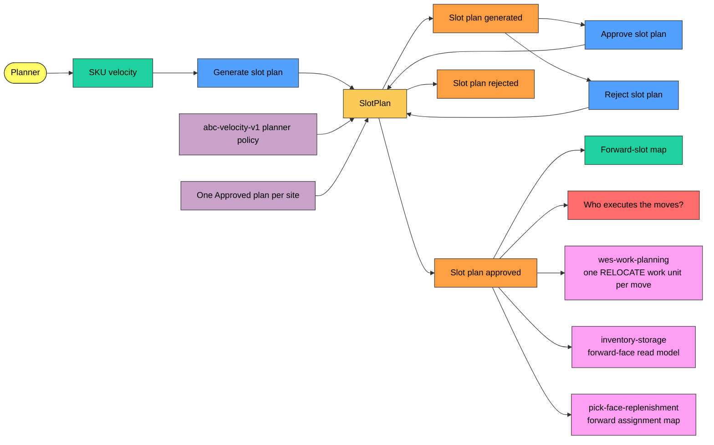
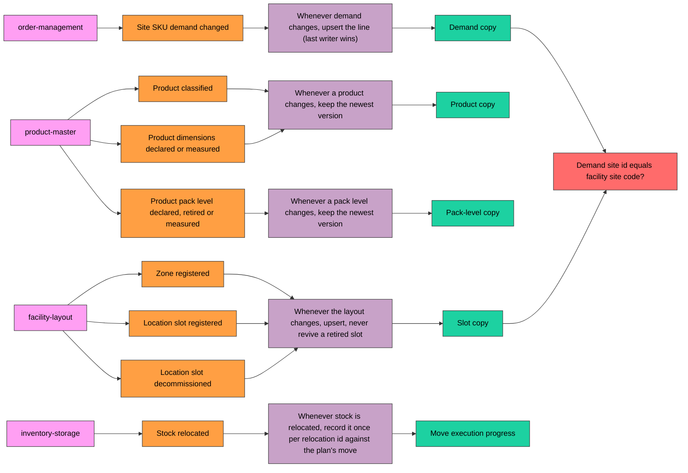

# EventStorming

A design-level EventStorming of `slotting-optimization`, using the sticky
colours of the ddd-crew
[EventStorming glossary and cheat sheet](https://github.com/ddd-crew/eventstorming-glossary-cheat-sheet):
**orange** domain event, **blue** command, **yellow** aggregate, **lilac**
policy, **green** read model, **pink** external system, **red** hotspot,
small yellow actor.

## Planning flow

The three sibling consumers of `SlotPlanApproved` are in wes-work-planning
(`internal/adapters/inbound/kafka/consumer.go`), inventory-storage
(`internal/adapters/inbound/kafka/slot_plan_consumer.go`) and
pick-face-replenishment (`internal/adapters/inbound/kafka/slotting_consumer.go`),
each on its `origin/develop`.

Source: `internal/application/usecases/{generate_plan,decide_plan,queries}.go`,
`internal/domain/slotplan/plan.go`, `internal/domain/planning/planner.go`.

## Local-copy flow

Source: `cmd/api/wire_kafka.go` (`consumerSpecs`: five consumers),
`internal/adapters/inbound/kafka/{demand,product,packlevel,layout,stock}_consumer.go`,
`internal/application/usecases/consumers.go`,
`internal/adapters/outbound/postgres/read_models.go`.

## Hotspots

| Hotspot | Why it is open | Where it shows |
| --- | --- | --- |
| Who executes the moves? | decided by ADR 0010 (supersedes ADR 0007): wes-work-planning plans one RELOCATE work unit per move of `SlotPlanApproved`, fulfillment-execution executes it, inventory-storage records `StockRelocated`, and this context records the progress per move | resolved; open follow-up: gating new proposals on unfinished execution is out of scope in v1 |
| Demand site id equals facility site code? | `ForwardSlots` joins `zones.site_code` to the plan's site, which comes from demand `site_id`; ADR 0003 calls for verifying this against live data | a mismatch makes every SKU `NoEligibleSlot` |
| Lexical slot ranking | layout events carry no travel distance, so v1 ranks slots by location code; `LocationGeometryUpdated` is ignored | "best" slot means "first code", not "closest" |
| No Kong route to the reports Service, web remote not deployed | the chart routes the api, the MCP server and the A2A agent through Kong, but renders no route for `cmd/slotting-reports`, and warehouse-infra deploys no `slotting_mfe` image | [Integration](/docs/ecosystem/integration#edge-and-infrastructure), [Runbook](/docs/operations/runbook#deployment) |
