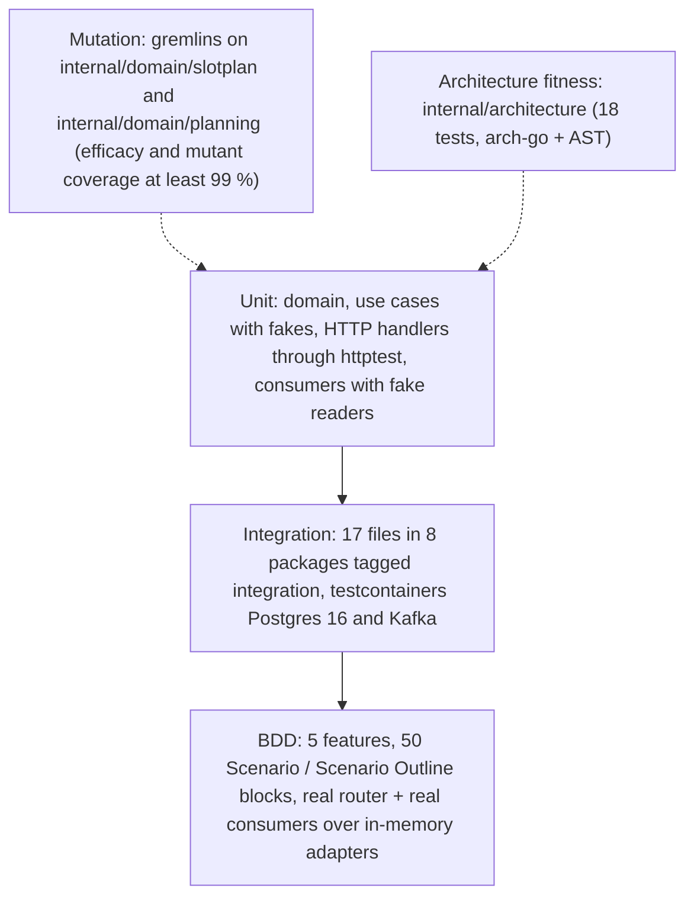

# Testing

The test pyramid as it exists on `develop`, the `make` targets that run each
layer, and the CI jobs that gate a pull request. Every count on this page
was taken from the repository on 2026-10-10 (`develop` at `ab0f53e`) and
updated on 2026-10-12 for the gap-fix wave (attempt cap, trace context,
sensors, chart render test).

Source: `Makefile`, `.github/workflows/ci.yml`, `features/*.feature`,
`.gremlins.yaml`, `internal/architecture/*_test.go`.

## Make targets

| Target | Command | Needs | In `check` / `check-all` |
| --- | --- | --- | --- |
| `make test` | `go test ./... -race` | nothing (no database, no broker) | both |
| `make coverage` | `go test ./... -race -coverprofile=coverage.out -coverpkg=./internal/domain/...,./internal/application/...` plus the 90 % gate | nothing | `check-all` |
| `make bdd` | `go test ./... -run TestFeatures -v` | nothing | `check-all` |
| `make arch-test` | `go test ./internal/architecture/... -v` | nothing | `check-all` |
| `make integration` | `go test -tags=integration ./... -race -count=1` | Docker only | neither |
| `make mutation` | `gremlins unleash` on `./internal/domain/slotplan`, then `./internal/domain/planning` | gremlins `v0.6.0` | neither |
| `make mutation-full` | `gremlins unleash ./internal/domain --workers 1 --timeout-coefficient 30` | gremlins | neither |
| `make lint` | `golangci-lint run ./...` (complexity limits in `.golangci.yml`) | golangci-lint `v2.14.0` | both |
| `make vuln` | `govulncheck ./...` | govulncheck | neither |
| `make check` | `fmt-check vet build lint test` | | the pre-commit gate |
| `make check-all` | `check coverage arch-test bdd` | | run before pushing |
| `make check-fast` | `fmt-check vet arch-test` plus the tests of the Go packages changed vs `HEAD` | python3 | the agent Stop hook |

lefthook (`lefthook.yml`) runs `fmt-check`, `vet` and `lint` on commit and
`make check` on push.

## Unit tests

Plain `go test`, no build tag, no I/O.

| Area | Where | What it pins |
| --- | --- | --- |
| Aggregate | `internal/domain/slotplan/{plan,values}_test.go` | every invariant of `Restore`, the `Draft -> Approved/Rejected`, `Approved -> Superseded` transitions, the events and their headers |
| Execution (ADR 0010) | `internal/domain/slotplan/execution_test.go` | `ParseMoveRef` (`<plan_id>:<move_seq>`, digits only), `NewRelocation` required fields, `MatchRef` / `MatchBins` per kind and every unmatched reason, `Progress` (executed moves, summed quantities, latest instant, out-of-range positions ignored) |
| Planner | `internal/domain/planning/planner_test.go` | candidates, ABC thresholds, hazmat and temperature compatibility, capacity, stickiness, move diffing, determinism |
| Use cases | `internal/application/usecases/*_test.go` with `fakes_test.go` | unit-of-work boundaries, version guards, supersede-on-approve, consumer outcomes (`applied`, `duplicate`, `stale`, `ignored`); `record_relocation_test.go`: reference first, bins fallback, unmatched is claimed not recorded, CloudEvents-id and relocation-id dedupe, invalid facts touch nothing, transient errors roll back, `GetPlan.View` progress |
| HTTP | `internal/adapters/inbound/http/*_test.go` (not `_integration`) | routes through `httptest`, problem mapping, readiness |
| Kafka in | `internal/adapters/inbound/kafka/*_test.go` | dispatch by full `type`, skip vs retry, backoff sequence, dead-lettering with fake readers and writers; `stock_consumer_test.go`: inventory-storage's AsyncAPI `StockRelocated` example decoded byte for byte (`testdata/inventory_StockRelocated.golden.json`), the move reference, poison dead-lettered at once, unmatched committed, other types skipped, shutdown never dead-letters; `TestDomainDLQWriter_TopicComesFromTheMessage` |
| HTTP / MCP execution view | `internal/adapters/inbound/http/execution_handlers_test.go`, `internal/adapters/inbound/mcp/execution_tool_test.go` | `execution` on `GET /slot-plans/{planId}` and `get_slot_plan` (camelCase vs snake_case, omitted fields) |
| Kafka out, relay | `internal/adapters/outbound/{kafka,outbox}/*_test.go` | CloudEvents encoding (golden), sink settings, relay batching; the attempt cap over the in-memory store (`relay_cap_test.go`: `TestRelay_MaxAttempts_PoisonRowExcludedThenGoodRowPublishes`, `TestRelay_NoCap_PoisonRowBlocksLaterRows`, `TestRelay_MaxAttemptsNegativeIgnoredAndDefaultIsTwenty`, `TestRelay_SendFailureCarriesTheRow`; ADR 0008) |
| In-memory adapters | `internal/adapters/outbound/memory/memory_test.go` | the shared repository contract in `internal/testing/repocontract` |
| Composition root | `cmd/api/main_test.go`, `outbox_relay_config_test.go`, `logger_level_test.go`; `cmd/mcp/main_test.go` | env parsing (publisher and consumer modes, relay interval, `OUTBOX_MAX_ATTEMPTS` (`TestOutboxMaxAttempts`, `TestDefaultOutboxMaxAttemptsIsTwenty`), `LOG_LEVEL` incl. `warning` (`TestNewLoggerLevels` in both binaries), `LOOKBACK_DAYS`, `FORWARD_ZONE_CODES`, `DEMAND_SITE_ID`/`DEFAULT_SITE_ID`, drain delay, `MIGRATIONS_DATABASE_URL`), boot refusals, consumers and relay start and stop, an in-memory end-to-end run |
| Boot retry, telemetry, ids, clock | their packages | |

## Integration tests (testcontainers)

Eighteen files in eight packages carry `//go:build integration`:

| Package | Files | Backing services and what the suite proves |
| --- | --- | --- |
| `internal/adapters/outbound/postgres` | `main_integration_test.go`, `repositories_integration_test.go` | Postgres: the same `repocontract` suite the memory adapters pass (`TestSlotPlanRepoContract`, `TestDemandLedgerContract`, `TestProfileDirectoryContract`, `TestSlotCatalogueContract`, `TestMoveExecutionLedgerContract`), the execution ledger joining the unit of work (`TestMoveExecutionLedgerJoinsTheUnitOfWork`), one Approved plan per site enforced by the database, the unit of work committing or rolling back plan, outbox and claim together, claim-once, outbox drain order and failure handling |
| `internal/adapters/outbound/postgres/pgtx` | `pgtx_integration_test.go` (its own `TestMain`) | Postgres: the transaction bracket every write relies on, through the real repositories and `postgres.UnitOfWork`. A plan save and its outbox rows commit together (`TestPgtx_SaveAndPublishCommitAtomically`); an error inside the scope rolls back the plan, the outbox rows and the processed-event claim (`TestPgtx_AnErrorInsideTheScopeRollsEverythingBack`); a reader on the pool sees nothing before commit (`TestPgtx_ReposOutsideTheScopeSeeNothingUntilCommit`); a nested `Do` joins the outer transaction (`TestPgtx_NestedUnitOfWorkJoinsTheOuterTransaction`); `pgtx.With`/`pgtx.From` carry a bare pgx transaction to the repositories (`TestPgtx_ExplicitWithFromCarriesTheTransactionToAnyQuerier`) |
| `internal/adapters/outbound/outbox` | `main_integration_test.go`, `relay_integration_test.go`, `relay_cap_integration_test.go`, `outbox_trace_integration_test.go` | Postgres + Kafka: `TestRelay_RealPostgresAndKafka_PublishesCloudEventsKeyedByPlanID`. The attempt cap over real Postgres (ADR 0008): a poison row is excluded after the cap, logged once at ERROR with id, topic, type and key, and the good row of the same key behind it publishes (`TestOutboxRelay_MaxAttempts_PoisonRowExcludedThenGoodRowPublishes`); the runbook's re-arm SQL makes it claimable again (`TestOutboxRelay_MaxAttempts_ReArmedRowIsClaimedAgain`); without a cap the poison row blocks everything (`TestOutboxRelay_NoCap_PoisonRowBlocksLaterRows`). Trace continuity (ADR 0009): the approve request's `traceparent` is stored in `outbox_events.headers`, relayed by a background pass and extracts to the request span (`TestOutboxTrace_TraceparentCrossesTheOutboxToKafka`); a row without stored headers relays unchanged with none (`TestOutboxTrace_RowWithoutTraceHeadersRelaysUnchanged`) |
| `internal/adapters/outbound/kafka` | `main_integration_test.go`, `publisher_integration_test.go` | Kafka: the production `Encoder` and `RelaySink` (the writer settings `cmd/api` builds) publish the aggregate's three event kinds, then the test reads them back from the broker and asserts the CloudEvents 1.0 envelope (`specversion`, `id`, `source`, the `com.warehouse.wms.slotting-optimization.slotplan.<Event>` type), the `content-type` header, the payloads pinned in `apis/asyncapi.yaml` and a re-sent outbox row carrying the same CloudEvents `id` (`TestKafkaPublisher_RealBrokerPublishesTheCloudEventsContract`); every event of one plan carries the plan id as the Kafka key (`TestKafkaPublisher_OnePlanSticksToOnePartitionKeysOrdering`) |
| `internal/adapters/inbound/http` | `main_integration_test.go`, `helpers_integration_test.go`, `idempotency_integration_test.go` | Postgres: the `Idempotency-Key` middleware (400 without a key, replay of the original plan, 422 on a different body, different keys make different plans, a rejected request is cached too, concurrent requests with one key create one plan), approve end to end, racing approvals of one site leave one Approved plan |
| `internal/adapters/inbound/kafka` | `main_integration_test.go`, `consumers_integration_test.go`, `stock_consumer_integration_test.go` | Postgres + Kafka: the demand, product and layout consumers end to end; the StockRelocated consumer (ADR 0010, `TestStockConsumer_RealKafkaAndPostgres`): a relocation with the move reference updates the plan's progress, a redelivery and a replay under a new id count once, an unmatched relocation is committed past, and the poison message is the only one on `warehouse.inventory.events.dlq` |
| `cmd/mcp` | `main_integration_test.go` | Postgres: the MCP binary migrates a database itself, reads through every tool what the api's write use cases persisted, and adds no outbox row (`TestMCPAgainstPostgres_ReadsWhatTheAPIWroteAndNeverWrites`) |
| `internal/application/usecases` | `main_integration_test.go`, `wiring_integration_test.go` | Postgres: the write use cases wired like `cmd/api` (real Postgres repositories, unit of work, CloudEvents encoder and read-model adapters; only the clock is fixed). The local copies are seeded through the real ledger, profile directory and slot catalogue, then generate, approve, a second approval that supersedes the first, regeneration stickiness and a rejection are checked against the persisted state and the read models (`TestUsecases_WiringPlanLifecycleEndToEnd`). Every outbox row the lifecycle wrote is decoded as a CloudEvents 1.0 envelope with its pinned payload (`TestUsecases_WiringPublishedEventsCarryTheCloudEventsContract`) |

`internal/testing/pgtest` starts one `postgres:16-alpine` container per test
binary and clones a migrated template database per test (`pgtest.NewPool(t)`);
`internal/testing/kafkatest` starts one `confluentinc/confluent-local:7.6.1`
broker per test binary and gives each test its own timestamp-suffixed topic
(`kafkatest.Topic`). Both start their container lazily, on first use. Each
integration package has a `TestMain` that runs the tests and then calls
`pgtest.Shutdown()` and/or `kafkatest.Shutdown()`. Neither helper reads
`DATABASE_URL` or `KAFKA_BROKERS` and neither skips, so a missing Docker
daemon fails the run. Two fitness tests keep it that way
(`TestPostgresIntegrationTestsUseTestcontainers`,
`TestKafkaIntegrationTestsUseTestcontainers`). They check imports, so a
suite that only goes through the helpers still names the testcontainers
module itself: the Kafka check wants `testcontainers-go/modules/kafka` in
every Kafka-touching `_integration_test.go` file (the publisher suite keeps a
`tckafka` reference for that), and the Postgres check wants
`testcontainers-go/modules/postgres` somewhere in each package that uses
pgx or `database/sql` (the `usecases` and `pgtx` suites keep a `tcpostgres`
reference).

`make integration` and the CI `integration` job both run
`go test -tags=integration ./... -race -count=1`, so every package above runs
in CI with no explicit package list to keep in sync.

## BDD (godog)

`features_test.go` (`TestFeatures`) and `features_wave2_test.go` drive the
real chi router over HTTP and feed the local copies through the real
consumers' `HandleMessage` with raw CloudEvents, over the in-memory adapters
wired the way `cmd/api` wires them, with a fixed clock (2026-10-08 12:00 UTC)
and sequential plan ids. Strict mode: an undefined step fails.

| Feature file | Scenario / Scenario Outline blocks |
| --- | --- |
| `features/generate_plan.feature` | 9 |
| `features/generate_plan_request.feature` | 6 |
| `features/approve_and_reject.feature` | 10 |
| `features/plan_decisions_and_events.feature` | 20 |
| `features/velocity_and_listing.feature` | 5 |
| **Total** | **50** (7 of them are outlines with example tables) |

## Mutation testing

`.gremlins.yaml`: `workers: 1`, `timeout-coefficient: 30`, thresholds
`efficacy: 99` and `mutant-coverage: 99` (gremlins fails at or below the
threshold). Measured on 2026-10-08: `internal/domain/slotplan` 72 killed / 0
lived, `internal/domain/planning` 46 killed / 0 lived, both 100 %.

## Architecture fitness tests

`internal/architecture` (`make arch-test`, CI job `arch-test`):

| Test | Rule |
| --- | --- |
| `TestHexagonalArchitecture` | domain imports nothing from application or adapters; `ports` holds interfaces only; adapters never import each other (arch-go) |
| `TestMCPAdapterDependencyRule` | the MCP adapter (`internal/adapters/inbound/mcp`) depends only on the application and domain layers and nothing imports it |
| `TestMCPOptionalToolInputsCarryOmitempty`, `TestMCPOptionalToolInputsSensorFailsOnBadFixtures` | an MCP tool input whose `jsonschema` description calls it optional (`optional` / `omitted`) has `omitempty` in its `json` tag, or the SDK would mark it required (gap fix D16) |
| `TestOutboxRelaysPassAttemptCap`, `TestOutboxRelayCapSensorFailsOnBadFixtures` | every non-test file under `cmd/` that builds an outbox relay passes `WithMaxAttempts` (gap fix D12, ADR 0008) |
| `TestNoAuthMiddlewareReintroduced` | no auth middleware on the router (fleet decision) |
| `TestKafkaConsumerGroupNeverHardcodedInline` | group ids come from the environment |
| `TestKafkaIntegrationTestsUseTestcontainers`, `TestPostgresIntegrationTestsUseTestcontainers`, `TestPostgresIntegrationSensorFailsOnBadFixtures` | integration tests boot real containers and never skip |
| `TestNoEventEnvelopeToggleOrFlatEnvelope`, `TestCloudEventsOnly` | CloudEvents 1.0 only, built in one package |
| `TestReplayConsumersSetCommitInterval` | a reader whose `GroupID` is a per-run unique group must set `CommitInterval` (no such reader exists here; the three consumers use env-provided groups and synchronous commits) |
| `TestEventCatalogueMatchesContract`, `TestEventCatalogueDetector` | the published types match `apis/asyncapi.yaml` |
| `TestKafkaWritersSetRequiredAcks`, `TestKafkaWriterAcksSensorBites` | Every kafka-go `Writer` composite literal in a non-test file under `internal/` or `cmd/` sets `RequiredAcks` (the import alias is resolved per file). kafka-go defaults it to `RequireNone` (acks=0): the broker never confirms the write, so a broker blip silently drops the message while `WriteMessages` returns nil. The twin proves the sensor flags a bad fixture under any alias. |

## Contract and API checks

There is no schemathesis (or other runtime contract) job in this repository.
The contracts are checked statically: the `api-lint` job runs Spectral on
`apis/openapi.yaml` (`.spectral.yaml`) and `apis/asyncapi.yaml`
(`.spectral.asyncapi.yaml`) with `--fail-severity=warn`, and the CloudEvents
golden tests plus `TestEventCatalogueMatchesContract` tie the encoder to the
AsyncAPI document.

## Evals

`EVALS.md` records the harness evaluations (`tools/harness_eval.py`,
`tools/harness_eval2.py`): agent runs against inventory-storage and
fulfillment-execution comparing guided and unguided agents. They are not
tests of this service and do not run in CI.

## CI

`.github/workflows/ci.yml` (on push to `main`/`develop`, every pull request
into them, weekly schedule, manual dispatch):

| Job | Runs | On a PR into `develop` |
| --- | --- | --- |
| `lint` | golangci-lint `v2.14.0` | blocking |
| `guide-lint` | `scripts/harness/guide_lint.py` and `test_hook.py` | advisory (`continue-on-error`) |
| `complexity` | golangci-lint with only `gocyclo,gocognit,cyclop,funlen,nestif`, plus an informational gocyclo report | blocking |
| `test` | `go build`, `go vet`, `go test ./... -race` with coverage over domain and application, 90 % gate | blocking |
| `bdd` | `go test ./... -run TestFeatures -v` | blocking |
| `integration` | `go test -tags=integration ./... -race -count=1` (testcontainers on the runner's Docker) | blocking |
| `mutation-fast` | gremlins on `slotplan` and `planning` | blocking |
| `mutation` | gremlins on `./internal/domain` | skipped (schedule and dispatch only); opens or closes a `harness:red` issue |
| `drift` | deadcode, `go mod tidy -diff`, coverage-quality report | skipped (schedule and dispatch only), advisory |
| `api-lint` | Spectral on both specs | blocking |
| `vuln` | `govulncheck ./...` | blocking |
| `arch-test` | `go test ./internal/architecture/... -v` | blocking |
| `helm-lint` | `ct lint` and the Service selector test | pull requests only |
| `chart-tests` | `charts/slotting-optimization/tests/render_test.sh` (the api Deployment mounts the ConfigMap with `envFrom`; `OUTBOX_MAX_ATTEMPTS` defaults to 20 and renders `0`; every `os.Getenv` / `getenv` literal of `cmd/api/main.go` and `cmd/mcp/main.go` is rendered into its Deployment; no ConfigMap key is read by no binary; mcp does not mount the ConfigMap) and `test_service_selectors.py` | every push and PR; not a required check (branch protection unchanged) |
| `docker-publish`, `release` | image, signature, SBOM, Helm chart, GitHub release | skipped (push to `main` only) |

Other workflows: `docs.yml` builds this site on every pull request touching
`docs/**` or `apis/**` and deploys GitHub Pages from `main`; `selftest.yml`
runs the harness template's own checks (hook tests, `repo_lint` tests,
Python compile, the architecture tests, the migration tool); `ai-review.yml`
is the automated review workflow.
