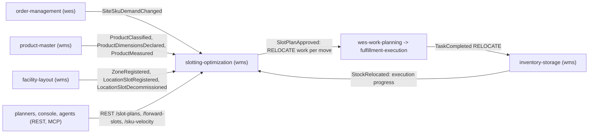

# Integration

Every edge between `slotting-optimization` and the rest of the fleet, as the
code on `develop` builds it. The service has **no outbound HTTP or MCP
client**: it never calls a sibling. Everything it knows about demand,
products, slots and executed moves arrives on Kafka and is kept in local
copies (ADR 0003, ADR 0010); everything it decides leaves on Kafka through
the transactional outbox (ADR 0004).

Topics: `warehouse.order-management.events`, `warehouse.product-master.events`,
`warehouse.facility.events`, `warehouse.inventory.events` (in) and
`warehouse.slotting-optimization.events` (out).

Source: `internal/adapters/inbound/kafka/{demand,product,layout,stock}_consumer.go`,
`internal/adapters/outbound/kafka/encoder.go`,
`internal/adapters/inbound/http/server.go`, ADR 0001 (context map),
[ADR 0010](/docs/adr/0010-approved-slot-plans-are-executed-as-wes-relocation-work)
(execution).

## Upstream

All four are **Conformist** edges over the producer's Published Language:
the payloads are restated in Go structs (never imported) and in
`apis/asyncapi.yaml`, and the full CloudEvents `type` string is the dispatch
key. Each producer was checked on its own `origin/develop` on 2026-10-09:
the topic constant and the type strings below exist in its code.

| Producer | Topic | Type consumed | Fields read | Effect here |
| --- | --- | --- | --- | --- |
| `order-management` | `warehouse.order-management.events` | `com.warehouse.wes.order-management.siteskudemand.SiteSkuDemandChanged` | `source_order_id`, `line_no`, `site_id`, `sku`, `demanded_units`, `due_at`, `state` (`ACTIVE` or `REMOVED`) | upsert of `demand_lines` by `(source_order_id, line_no)`, last writer wins; dropped when `DEMAND_SITE_ID` names another site |
| `product-master` | `warehouse.product-master.events` | `com.warehouse.wms.product-master.product.ProductClassified` | `sku`, `handling_tags`, `temperature_class`, `version` | replaces the classification in `product_profiles` if `version` is newer |
| `product-master` | same | `com.warehouse.wms.product-master.product.ProductDimensionsDeclared`, `com.warehouse.wms.product-master.product.ProductMeasured` | `sku`, `effective.volume_mm3`, `effective.weight_g`, `effective_source`, `version` | replaces the effective unit size if `version` is newer; `effective_source = none` clears it |
| `facility-layout` | `warehouse.facility.events` | `com.warehouse.wms.facility-layout.zone.ZoneRegistered` | `zoneId`, `siteCode`, `areaCode`, `zoneCode`, `temperatureClass`, `hazmat` | upsert of `zones` |
| `facility-layout` | same | `com.warehouse.wms.facility-layout.locationslot.LocationSlotRegistered` | `locationCode`, `zoneId`, `role` (empty means `Storage`), `maxWeightKg`, `maxVolumeM3` | upsert of `slots` unless the slot was decommissioned |
| `facility-layout` | same | `com.warehouse.wms.facility-layout.locationslot.LocationSlotDecommissioned` | `locationCode` | `slots.active = false`, for good |
| `inventory-storage` (its ADR 0039) | `warehouse.inventory.events` | `com.warehouse.wms.inventory-storage.stock.StockRelocated` | `relocation_id`, `site_code`, `sku`, `from_bin`, `to_bin`, `quantity`, `source_ref`, `occurred_at` | matched to a plan's move (`source_ref` = `<plan_id>:<move_seq>` first, else `site_code` + `sku` + bins on the site's Approved plan) and recorded in `slot_plan_move_executions` once per `relocation_id`; unmatched relocations are counted, not stored (ADR 0010) |

Every other type on those topics (for example `FacilityLayoutImported` or
`LocationGeometryUpdated` on the facility topic, `StockReserved` on the
inventory topic) is ignored.

On the slot-plan path `source_ref` is fulfillment-execution's
`relocation_ref` (`<plan_id>:<move_seq>`, its ADR 0047), which
inventory-storage's RELOCATE branch stores as the relocation's source_ref
(it falls back to the task id when the producer sent none). `move_seq` is
the 0-based position of the move in `SlotPlanApproved.moves`, the order
wes-work-planning numbers the moves in (its ADR 0040).

### Failure behaviour (inbound)

| Situation | Behaviour |
| --- | --- |
| Producer down or silent | nothing breaks; the copy goes stale and the next plan is computed from what it holds. Plans list unplaceable SKUs with a reason instead of guessing. |
| Broker down | the readers retry inside kafka-go; boot is not blocked. |
| Message is not CloudEvents 1.0, payload malformed, values invalid (demand, product, layout) | logged at WARN and committed past (never retried, never dead-lettered) |
| `StockRelocated` whose data cannot be decoded or misses a required field | dead-lettered at once to `warehouse.inventory.events.dlq` (no retry) and committed past |
| `StockRelocated` that matches no move (unknown plan or move, other site, or any relocation whose `reason` is not `SLOTTING`: manual, consolidation, replenishment) | claimed, logged at INFO and counted (`slotting_optimization.relocations.observed{outcome="unmatched"}`), never dead-lettered |
| Shutdown (context cancelled) mid-message | never dead-lettered: the offset stays uncommitted and the message is redelivered |
| Transient failure (Postgres) | same message retried with backoff, 5 attempts, then `<topic>.dlq` |
| Redelivery | `processed_events` claim makes it a no-op (`outcome=duplicate`) |
| Out-of-order product events | the `version` guard keeps the newest (`outcome=stale`) |
| Consumer behind or its broker down | the copy is whatever the database already holds; the consumers always run (`*_MODE` accepts only `kafka`, ADR 0011) and the process exits non-zero when one dies on its own |

## Downstream

| Consumer | Protocol | Contract | State on `develop` |
| --- | --- | --- | --- |
| any subscriber of `warehouse.slotting-optimization.events` | Kafka, CloudEvents 1.0 structured mode, key = plan id, optional W3C `traceparent` header of the writing request ([ADR 0009](/docs/adr/0009-trace-context-crosses-the-outbox)) | `com.warehouse.wms.slotting-optimization.slotplan.SlotPlanGenerated`, `...SlotPlanApproved` (full `{sku, slot}` map, the moves, `supersedes_plan_id`), `...SlotPlanRejected`; dataschema `urn:warehouse:slotting-optimization:events:<EventName>:v1` ([Domain events](/docs/ddd/domain-events)) | `wes-work-planning` consumes `SlotPlanApproved` (below); nothing consumes `SlotPlanGenerated` or `SlotPlanRejected` |
| planners, `warehouse-console`, `warehouse-ops-agent` | REST (Open Host Service), unauthenticated | `apis/openapi.yaml`: `POST /slot-plans`, `GET /slot-plans`, `GET /slot-plans/{planId}`, `POST /slot-plans/{planId}/approve`, `POST /slot-plans/{planId}/reject`, `GET /forward-slots`, `GET /sku-velocity` | the API is built; no console remote and no agent tool call it yet. `CORS_ALLOWED_ORIGINS` defaults to the console's dev origin `http://localhost:5173`. |
| `wes-work-planning` -> `fulfillment-execution` -> `inventory-storage` | Kafka | `SlotPlanApproved`: one RELOCATE work unit per move, sequenced inside the plan (a move into a slot another move vacates waits for that vacate) and superseded by a newer plan's approval (not-yet-released work is cancelled); released on the `RELOCATE` process path (process-path-management ADR 0033, intake `SLOT_RELOCATION`, ADR 0034); executed as a fulfillment-execution RELOCATE task (its ADR 0047) whose `TaskCompleted` inventory-storage applies as `RelocateStock` (its ADR 0039) | **built** in those contexts (wes-work-planning ADR 0040); decided by [ADR 0010](/docs/adr/0010-approved-slot-plans-are-executed-as-wes-relocation-work), which supersedes [ADR 0007](/docs/adr/0007-executing-an-approved-slot-plan). The resulting `StockRelocated` comes back upstream (above) as execution progress. |
| MCP clients | MCP (Streamable HTTP) | read tools `get_slot_plan` (with `execution`, ADR 0010), `list_slot_plans`, `get_forward_slots`, `get_sku_velocity` | built: `cmd/mcp` (ADR 0005), unauthenticated, read-only |

### Failure behaviour (outbound)

The plan row and its outbox rows commit in one transaction, so a decision is
never lost and never published without being stored. A broker outage only
delays publication: the relay retries every `OUTBOX_RELAY_INTERVAL`, in id
order, with the original CloudEvents ids, and stops at the first failing
row so per-plan order holds. A row that fails `OUTBOX_MAX_ATTEMPTS` times
(default 20) is excluded and logged at ERROR so the rows behind it move on;
later events of the same plan then overtake it until an operator re-arms it
([ADR 0008](/docs/adr/0008-outbox-relay-attempt-cap)). The relay always publishes to Kafka
(`EVENT_PUBLISHER` accepts only `kafka`): there is no log sink.

## Explicit non-edges

- **No command edge to `inventory-storage`**: this context never moves
  stock itself and does not change stow behaviour (ADR 0001). The stock moves
  of an approved plan are planned by wes-work-planning, executed by
  fulfillment-execution and recorded by inventory-storage; this context only
  reads the resulting `StockRelocated` (ADR 0010).
- **Proposals are not gated on execution** in v1: a new plan can be
  generated and approved while the previous one is half executed.
- **No edge to `inbound-receiving` or `warehouse-planning`.**
- **No request-time calls** in either direction: no sibling calls this
  service, and it calls none.

## Edge and infrastructure

The fleet edge (Kong `:8000`, `/api/<context>`) has no route for this
context yet; the Helm chart (`charts/slotting-optimization`) exists but
`warehouse-infra` does not deploy it yet; see
[Runbook](/docs/operations/runbook#deployment).
