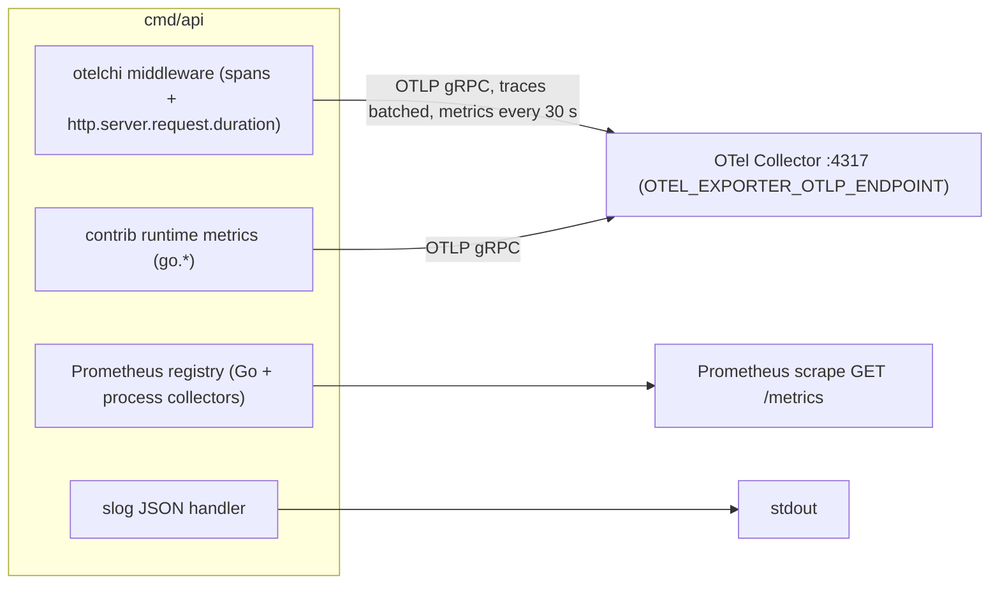

# Observability

`slotting-optimization` emits three signals: OpenTelemetry traces and
metrics pushed over OTLP/gRPC, a Prometheus scrape endpoint for runtime
metrics (`cmd/api` only), and JSON logs on stdout. It defines two business
counters of its own, `slotting_optimization.relocations.observed` and
`slotting_optimization.slot_plans.decided`, both emitted by `cmd/api`, and no
custom tracer. Everything else below comes from the libraries each binary
installs through the same `telemetry.Setup`.

| Binary | `service.name` | HTTP spans and `http.server.request.duration` | Custom instruments | Prometheus `/metrics` |
| --- | --- | --- | --- | --- |
| `cmd/api` | `slotting-optimization` | yes (`NewRouter`) | the two counters above | yes |
| `cmd/mcp` | `slotting-optimization-mcp` | yes (`cmd/mcp/router.go`) | none | no |
| `cmd/slotting-projector` | `slotting-optimization-projector` | no (the admin mux is a plain `http.ServeMux`, uninstrumented) | none: runtime metrics only | no |
| `cmd/slotting-reports` | `slotting-optimization-reports` | yes (`NewReportsRouter`: `/reports/slot-plan-funnel`, `/reports/freshness`, `/healthz`) | none | no |

## Pipeline



Source: `internal/adapters/outbound/telemetry/telemetry.go`,
`internal/adapters/outbound/telemetry/metrics.go`,
`internal/adapters/inbound/http/server.go`, `cmd/api/main.go` (`newLogger`).

| Setting | Value | Source |
| --- | --- | --- |
| Exporter | OTLP/gRPC, insecure, to `OTEL_EXPORTER_OTLP_ENDPOINT` (default `localhost:4317`) for traces and metrics | `telemetry.Setup` |
| Connection | lazy and non-blocking: no Collector means spans and metrics are dropped, the service still starts | `telemetry.Setup` |
| Metric push interval | 30 s (`metricExportInterval`) | `telemetry.go` |
| Propagation | W3C `traceparent` and `baggage` on HTTP. Through Kafka: the request span's `traceparent` (and `tracestate` / `baggage` when present) is stored in `outbox_events.headers` at insert and sent as Kafka headers by the relay ([ADR 0009](/docs/adr/0009-trace-context-crosses-the-outbox)); a consumer that extracts it continues the producing request's trace. This service's own consumers open no spans, so they do not extract | `telemetry.go`, `outbound/postgres/outbox_repository.go` (`traceHeaders`), `outbound/kafka/relay_sink.go` |
| Resource | `service.name=slotting-optimization`, `service.version=$SERVICE_VERSION` (default `dev`), `deployment.environment.name=$ENVIRONMENT` (default `local`) plus the SDK defaults | `telemetry.newResource` |
| Shutdown | providers flushed with a 5 s budget after everything else stopped | `cmd/api/main.go` (`setupTelemetry`) |

## Metrics

### OTLP (pushed)

| Instrument | Type | Unit | Attributes | Emitted by |
| --- | --- | --- | --- | --- |
| `http.server.request.duration` | Float64 histogram, buckets 5 ms to 10 s | `s` | `http.method`, `http.scheme`, `http.route` (the chi pattern, e.g. `/slot-plans/{planId}`) | `otelchimetric.NewServerRequestDuration` (riandyrn/otelchi v0.12.3), installed in `NewRouter` |
| `slotting_optimization.relocations.observed` | Int64 counter | `{relocation}` | `outcome` (`applied`, `duplicate`, `unmatched`), `reason` on `unmatched` (`unknown-plan`, `no-current-plan`, `plan-not-approved`, `site-mismatch`, `unknown-move`, `sku-mismatch`, `no-matching-move`) | `telemetry.RelocationMetrics`, recorded by `RecordRelocation` after its commit (ADR 0010) |
| `slotting_optimization.slot_plans.decided` | Int64 counter | `{plan}` | `outcome` (`approved`, `rejected`) | `telemetry.PlanDecisionMetrics`, created in `cmd/api/main.go`; recorded when an operator approves or rejects a Draft plan; OTLP only |
| `go.memory.used`, `go.memory.limit`, `go.memory.allocated`, `go.memory.allocations`, `go.memory.gc.goal`, `go.goroutine.count`, `go.processor.limit`, `go.config.gogc` | runtime gauges and counters | per semconv | per semconv | `go.opentelemetry.io/contrib/instrumentation/runtime` v0.72.0, started in `telemetry.Setup` |

`http.server.request.duration` carries **no status-code attribute** in this
otelchi version, so error rates come from the trace spans
(`http.status_code`) or from the logs, not from this histogram.

### Prometheus (`GET /metrics`)

A private registry with only `collectors.NewGoCollector()` and
`collectors.NewProcessCollector()`: the `go_*` and `process_*` families
(`go_goroutines`, `go_memstats_*`, `process_cpu_seconds_total`,
`process_resident_memory_bytes`, `process_open_fds`, ...). The HTTP and
business picture is only on the OTLP side; this endpoint keeps the pod
scrapeable without a Collector (`telemetry.NewMetricsHandler`).

### What is not measured

No counter exists for plans generated, outbox lag, consumer lag, the outcomes
of the demand, product and layout consumers, the projector's applied,
skipped or dead-lettered events, or dead-lettered messages in general. Use
the database and the broker for those (queries below), the reports binary's
`GET /reports/freshness` for the projection's lag, or the log lines.

## Traces

| Span | Kind | Attributes | Source |
| --- | --- | --- | --- |
| one per HTTP request, named after the chi route pattern (`/slot-plans`, `/slot-plans/{planId}/approvals`, `/forward-slots`, `/sku-velocity`, `/healthz`, ...) | server | `http.route`, `http.status_code` and the otelchi request attributes | `otelchi.Middleware(DefaultServiceName, otelchi.WithChiRoutes(r))` in `server.go` |

There are no child spans: Postgres calls, the planner, the consumers and the
relay are not instrumented. A consumed message or a relay pass never has a
span.

## Logs

JSON lines from `log/slog` on stdout (`LOG_LEVEL`, default `info`). Fields
are the slog defaults `time`, `level`, `msg` plus the per-message keys below.
Trace ids are not injected into log lines.

| Message | Level | Fields | Emitted by |
| --- | --- | --- | --- |
| `postgres adapters configured` | INFO | | `cmd/api/main.go` |
| `retrying` / `succeeded after retry` | WARN / INFO | `op` (`run migrations`, `ping postgres`), `attempt`, `in`, `err` | `internal/bootretry` |
| `consumer running` | INFO | `consumer`, `topic`, `group_id`, `brokers` (one line per consumer, four in total) | `cmd/api/main.go` |
| `consumer stopped` | ERROR | `consumer`, `error` | `cmd/api/main.go` (reader failure; the process then exits non-zero) |
| `outbox relay running` | INFO | `publisher` (always `kafka`), `interval`, `max_attempts`, `topic` | `cmd/api/main.go` |
| `outbox relay stopped` | ERROR | `error` (the process then exits non-zero) | `cmd/api/main.go` |
| `http server listening` | INFO | `addr` | `cmd/api/main.go` |
| `event processed` | INFO | `type`, `event_id`, `subject`, `outcome` (`applied`, `duplicate`, `stale`, `ignored`) | `inbound/kafka/consumer.go` (`logOutcome`) |
| `skipping a message that is not a valid CloudEvent` | WARN | `consumer`, `topic`, `error` | `inbound/kafka/consumer.go` |
| `skipping an event that can never be applied` | WARN | `consumer`, `type`, `event_id`, `error` | `inbound/kafka/consumer.go` |
| `<consumer> handling failed; retrying the same message` | ERROR | `error`, `partition`, `offset`, `attempt`, `max_attempts`, `retry_in` | `inbound/kafka/kafka.go` |
| `<consumer> handling failed after the maximum attempts; dead-lettering the message` | ERROR | `error`, `partition`, `offset`, `attempts` | `inbound/kafka/kafka.go` |
| `<consumer> offset commit failed; retrying the same message` / `dead-letter publish failed; ...` | ERROR | `error`, `partition`, `offset`, `attempt`, `retry_in` | `inbound/kafka/kafka.go` (`retryUntilOK`) |
| `outbox relay pass failed` | ERROR | `error` (`outbox row <id> (<type>): <cause>`) | `outbound/outbox/relay.go` |
| `outbox relay: row reached the attempt cap and is excluded from future claims; ...` | ERROR | `outbox_id`, `topic`, `event_type`, `key`, `attempts`, `max_attempts`, `error` (once per row, ADR 0008) | `outbound/outbox/relay.go` |
| `request failed` | ERROR | `error`, `method`, `path` (only for a `500 internal-error`) | `inbound/http/response.go` |
| `invalid LOOKBACK_DAYS; using the default`, `invalid OUTBOX_RELAY_INTERVAL; using the default`, `invalid OUTBOX_MAX_ATTEMPTS; using the default`, `ignoring invalid SHUTDOWN_DRAIN_DELAY` | WARN | `value`, `default` | `cmd/api/main.go` |
| `shutdown: readiness flipped to not-ready; waiting for traffic to drain` | INFO | `drain_delay` | `cmd/api/main.go` |
| `worker did not stop before the shutdown drain deadline` | WARN | `worker` | `cmd/api/main.go` |
| `service exited with error` | ERROR | `error` (a boot error naming the variable, or `<worker> stopped unexpectedly: exiting so the orchestrator restarts the service`) | `cmd/api/main.go` (exit code 1) |
| `readiness: dependency is not ready` | WARN | `dependency` (`postgres`, `kafka`), `error` (at most once per 3 s cache window) | `inbound/http/readiness.go` |
| `telemetry configured` | INFO | `service_name`, `service_version`, `environment`, `otlp_endpoint` | `cmd/slotting-projector/main.go` |
| `projector admin server listening` / `analytics consumer running` | INFO | `addr` / `topic`, `group_id`, `brokers` | `cmd/slotting-projector/main.go` |
| `analytics: skipping message that is not a CloudEvents 1.0 event (further skips are counted, not logged, until the next interval)` | WARN | `error`, `topic`, `partition`, `offset`, `suppressed_since_last_warning` (at most one line per minute) | `inbound/kafka/analytics_consumer.go` |
| `analytics: ignoring event of another type` | DEBUG | `type`, `event_id` | `inbound/kafka/analytics_consumer.go` |
| `analytics: dead-lettering a message that can never be projected` | ERROR | `error`, `dlq_topic`, `partition`, `offset` | `inbound/kafka/analytics_consumer.go` |
| `slotting-projector exited with error` | ERROR | `error` (`ANALYTICS_DATABASE_URL is required ...`, `analytics consumer stopped unexpectedly: ...`, `admin server failed: ...`) | `cmd/slotting-projector/main.go` (exit code 1) |
| `analytics consumer returned an error at shutdown` / `analytics consumer did not stop before the shutdown deadline` | WARN | `error` | `cmd/slotting-projector/main.go` |
| `reports server listening` | INFO | `addr` | `cmd/slotting-reports/main.go` |
| `report query failed` | ERROR | `error`, `path` (the `500 report-store-error` answer never echoes it) | `inbound/http/reports_handler.go` |
| `slotting-reports exited with error` | ERROR | `error` | `cmd/slotting-reports/main.go` (exit code 1) |

A 4xx answer is not logged; it is visible in the span status and in the
RFC 7807 body (`type`, `title`, `status`, `detail`, `instance`).

## Dashboards and alerts

This repository has no dashboard JSON. warehouse-infra (`origin/develop`)
generates the Grafana dashboard `warehouse-slotting-optimization`
(`terraform/dashboards/contexts/slotting-optimization.json`, from
`scripts/gen-context-dashboards.py`): Kong request rate, 5xx ratio and p95
latency over the routes `slotting-optimization`, `-mcp` and `-reports`;
`http_server_request_duration_seconds` by route and by process for every
`service_name=~"slotting-optimization.*"`; Go goroutines and memory; and the
Loki log panels for `app="slotting-optimization"`. It has no panel for the two
business counters. The Kong regex includes a `-reports` route, but the chart
renders none, so that series stays empty.

Its alert rules (`terraform/alerting/warehouse-alert-rules.json`) for this
context are the group `warehouse-slotting-optimization`
(`WarehouseKong5xxRatioHigh`, `WarehousePodRestarting`) and
`warehouse-slotting-optimization-slo` (`WarehouseApiAvailabilityBurnFast`,
`WarehouseApiLatencyBurnFast`, `WarehouseApiAvailabilityBurnSlow`,
`WarehouseApiLatencyBurnSlow`), all linking to this site's runbook.

## Health queries

```sql
-- Outbox backlog and the oldest unpublished event (relay stuck or broker down)
SELECT count(*), min(created_at), max(attempts), max(last_error)
FROM outbox_events WHERE published_at IS NULL;

-- What the consumers applied in the last hour, per copy
SELECT consumer, count(*) FROM processed_events
WHERE processed_at > now() - interval '1 hour' GROUP BY consumer;

-- Freshness of each local copy
SELECT 'demand' AS copy, max(updated_at) FROM demand_lines
UNION ALL SELECT 'product', max(updated_at) FROM product_profiles
UNION ALL SELECT 'zones', max(updated_at) FROM zones
UNION ALL SELECT 'slots', max(updated_at) FROM slots;

-- Execution progress (ADR 0010): moves executed per plan, newest first
SELECT plan_id, count(DISTINCT move_seq) AS moves_executed, max(executed_at) AS last_executed_at
FROM slot_plan_move_executions GROUP BY plan_id ORDER BY last_executed_at DESC LIMIT 20;
```

```sql
-- Analytical database: what the projector applied, and its freshness basis
SELECT event_type, count(*), max(occurred_at) FROM analytics_processed_events GROUP BY event_type;

-- Plans still pending (generated, neither approved nor rejected yet)
SELECT site_id, count(*) FROM slot_plan_facts
WHERE generated_at IS NOT NULL AND approved_at IS NULL AND rejected_at IS NULL GROUP BY site_id;
```

Consumer lag lives in the broker: describe the groups set in
`DEMAND_CONSUMER_GROUP`, `PRODUCT_CONSUMER_GROUP`, `LAYOUT_CONSUMER_GROUP`,
`RELOCATION_CONSUMER_GROUP` and `ANALYTICS_CONSUMER_GROUP` with
`kafka-consumer-groups.sh --describe`.

## Suggested alerts

| Alert | Signal | Why |
| --- | --- | --- |
| Outbox backlog | `count(*)` of unpublished `outbox_events` older than 5 minutes greater than 0 | the relay is failing; plan decisions are not reaching Kafka |
| Dead letters | any message on `warehouse.order-management.events.dlq`, `warehouse.product-master.events.dlq` or `warehouse.facility.events.dlq` | a copy is missing data the next plan needs |
| Relocation poison | any message on `warehouse.inventory.events.dlq` from this consumer (`x-dlq-error` mentions `relocation`) | inventory-storage published a `StockRelocated` that misses a field; a move's progress is missing |
| Analytics poison | any message on `warehouse.slotting-optimization.analytics.dlq` | an event the projector can never apply; the funnel misses it |
| Projection stale | `lag_seconds` of `GET /reports/freshness` growing while plans are decided, or growing lag of `ANALYTICS_CONSUMER_GROUP` | the projector is down or retrying a transient failure forever |
| Unmatched relocations | rate of `slotting_optimization.relocations.observed` with `outcome="unmatched"` and `reason` one of `unknown-plan`, `unknown-move`, `sku-mismatch` above 0 | RELOCATE tasks refer to moves this context does not know: the move numbering of the plan and of wes-work-planning disagree |
| Consumer stuck | `handling failed; retrying the same message` logged for more than 1 minute, or growing group lag | a blocked partition |
| Readiness | `/readyz` 503 outside a rollout | the pod is shutting down or wedged in the drain |
| Latency | p95 of `http.server.request.duration` for `http.route=/slot-plans` above 2 s | plan generation approaching the 5 s statement timeout |
| Restarts | container restarts with `service exited with error` | migration or Postgres failure at boot |
