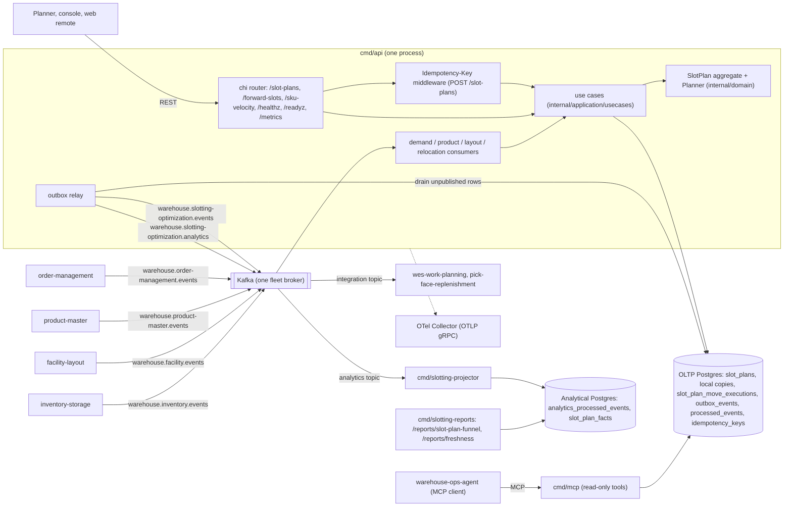
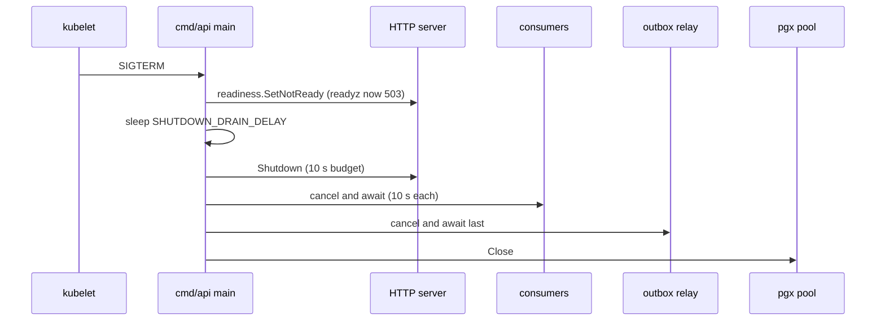

# Architecture

`slotting-optimization` is one Go module (`github.com/claudioed/slotting-optimization`)
built as a hexagonal (ports and adapters) service. It ships **five binaries**
in one image (`/app/<name>`, the `Dockerfile` builds every `cmd/*`
directory): `cmd/api` (the OLTP writer: REST, the four local-copy Kafka
consumers and the transactional-outbox relay in one process), `cmd/mcp` (the
read-only MCP server, ADR 0005), `cmd/a2a` (the read-only A2A agent, ADR 0013) and the analytics read side of ADR 0006,
`cmd/slotting-projector` (writer) and `cmd/slotting-reports` (reader).

## Binaries

| Binary | Role | Listens on | Background workers |
| --- | --- | --- | --- |
| `cmd/api` | Composition root: validates the environment (a missing `DATABASE_URL`, `KAFKA_BROKERS` or consumer group is a boot error before anything binds), builds the Postgres adapters, runs the embedded migrations, wires the use cases into the chi router, starts the consumers and the relay, and shuts everything down in order on `SIGINT`/`SIGTERM`; it exits non-zero when the relay or a consumer dies on its own. | `HTTP_ADDR` (default `:8080`): the REST API, `GET /healthz` (liveness), `GET /readyz` (Postgres ping + Kafka metadata), `GET /metrics` | demand, product, layout and relocation consumers (always on; `*_MODE` accepts only `kafka`), outbox relay (always on; `EVENT_PUBLISHER` accepts only `kafka`) |
| `cmd/mcp` | Read-only MCP server (ADR 0005): four tools over the same OLTP database through the query use cases. It runs the embedded OLTP migrations itself, never dials Kafka and starts no relay. | `MCP_ADDR` (default `:8090`): Streamable HTTP at `/` and `/mcp`, `GET /healthz` | none |
| `cmd/slotting-projector` | The only writer of the analytical database (ADR 0006): consumes `warehouse.slotting-optimization.analytics` under `ANALYTICS_CONSUMER_GROUP` (default `slotting-optimization-analytics`), applies the embedded analytical migration, and folds every `SlotPlanGenerated` / `SlotPlanApproved` / `SlotPlanRejected` into `slot_plan_facts`. Never opens the OLTP database. | `ADMIN_ADDR` (default `:8091`): `GET /healthz` and `GET /readyz` only (the readiness flips to 503 at shutdown) | the analytics consumer (dead letters to `warehouse.slotting-optimization.analytics.dlq`) |
| `cmd/slotting-reports` | Read-only HTTP reader of the analytical database (read-only pool, `default_transaction_read_only = on`). Never opens the OLTP database or Kafka. | `HTTP_ADDR` (default `:8092`): `GET /reports/slot-plan-funnel`, `GET /reports/freshness`, `GET /healthz` | none |

There is no other port: OpenTelemetry is pushed over OTLP/gRPC to
`OTEL_EXPORTER_OTLP_ENDPOINT` by every binary, each under its own
`service.name` (`slotting-optimization`, `slotting-optimization-mcp`,
`slotting-optimization-projector`, `slotting-optimization-reports`).

The web remote in `web/` (`slotting_mfe`, Vite + React Module Federation)
is a separate build with its own image (`frontend` component of the chart);
it calls the REST API of `cmd/api` only.

## Layers

| Layer | Package | Contents |
| --- | --- | --- |
| Domain | `internal/domain/slotplan` | The `SlotPlan` aggregate root, its value types (`PlanID`, `SiteID`, `SKU`, `SlotCode`, `Window`, `State`, `ABCClass`, `MoveKind`, `UnassignedReason`, `Assignment`, `Move`, `Unassigned`), its commands (`Generate`, `Approve`, `Reject`, `Supersede`, `Restore`) and its three events. |
| Domain | `internal/domain/planning` | The pure `Planner` domain service (policy `abc-velocity-v1`), the `SlotRankingPolicy` port and its v1 implementation `LexicalRanking`. No I/O, no clock. |
| Application | `internal/application/usecases` | Seven request use cases (`GeneratePlan`, `ApprovePlan`, `RejectPlan`, `GetPlan`, `ListPlans`, `ListForwardSlots`, `ListSkuVelocity`) and seven consumer use cases (`ApplyDemandChanged`, `ApplyProductClassified`, `ApplyPhysicalProfile`, `ApplyZoneRegistered`, `ApplyLocationSlotRegistered`, `ApplyLocationSlotDecommissioned`, `RecordRelocation`). |
| Application | `internal/application/ports` | Out-port interfaces only: `SlotPlanRepository`, `DemandLedger`, `ProfileDirectory`, `SlotCatalogue`, `IDGenerator`, `OutboxRepository`, `EventEncoder`, `PlanDecisionMetrics`, `ProcessedEvents`, `MoveExecutionLedger`, `RelocationMetrics`, `UnitOfWork`, `Clock`. |
| Application | `internal/application/repository`, `internal/application/outbox` | The ports' non-interface vocabulary: typed errors (`ErrPlanNotFound`, `ErrConcurrentModification`, `ErrApprovedPlanConflict`, `ErrProfileNotFound`), filters, local-copy value types and the outbox `Message`. |
| Analytics region | `internal/analytics/report` | The self-contained read model of ADR 0006: the funnel report shape, the range and granularity rules, percentiles and freshness, event validation, and the `Projection` (writer) and `Reader` ports. It imports no other internal package (arch test). |
| Inbound adapter | `internal/adapters/inbound/http` | chi router, RFC 7807 problem mapping (`errors.go`), the transactional `Idempotency-Key` middleware (`idempotency.go`), the NUL guard (`nul.go`), the readiness gate (`readiness.go`), DTOs; and the reports router of `cmd/slotting-reports` (`reports_handler.go`). |
| Inbound adapter | `internal/adapters/inbound/kafka` | The four consumers of `cmd/api` (`demand_consumer.go`, `product_consumer.go`, `layout_consumer.go`, `stock_consumer.go`), the projector's `AnalyticsConsumer` (`analytics_consumer.go`), the at-least-once run loop (`kafka.go`) and dead-lettering (`deadletter.go`). |
| Inbound adapter | `internal/adapters/inbound/mcp` | The MCP server and its four read-only tools (`tools.go`), used by `cmd/mcp`. |
| Shared adapter | `internal/adapters/kafka/cloudevents` | The only place a CloudEvents 1.0 envelope is built (`New`) or decoded (`Decode`). |
| Outbound adapter | `internal/adapters/outbound/postgres` | pgx repositories, the unit of work (`pgtx` carries the transaction in the context), the outbox store and the golang-migrate runner over the embedded `migrations/*.sql`. |
| Outbound adapter | `internal/adapters/outbound/analyticsstore` | The analytical store: `Projection` (writer pool, `MaxConns = 5`, `statement_timeout = 10s`), `Reader` (read-only pool, `MaxConns = 5`, `statement_timeout = 15s`), the migration runner over `analytics/migrations` and `Memory`, an in-memory twin for the shared contract test. |
| Outbound adapter | `internal/adapters/outbound/memory` | In-memory implementations of every port: test doubles only (the BDD suite and unit tests). `cmd/**` never imports it (`TestRuntimeBinaryHasNoInMemoryAdapters`, ADR 0011). |
| Outbound adapter | `internal/adapters/outbound/kafka` | `Encoder` (integration stream), `AnalyticsEncoder` (analytics stream), `FanoutEncoder` (what `cmd/api` uses: two outbox rows per event, one CloudEvents id), `RelaySink` (kafka-go writer) and the `/readyz` broker check (`health.go`). |
| Outbound adapter | `internal/adapters/outbound/outbox` | The relay loop. The package still defines a `LogSink`, but no binary wires it: `EVENT_PUBLISHER=log` is a boot error (ADR 0011). |
| Outbound adapter | `internal/adapters/outbound/telemetry`, `clock`, `ids` | OTLP tracer and meter providers plus the Prometheus handler, the system clock, `plan-<uuid v4>` ids. |
| Support | `internal/bootretry` | Exponential-backoff retry for the first Postgres dial (migrations and first ping) of every binary. |
| Fitness | `internal/architecture` | arch-go and AST fitness tests that keep the layering, the CloudEvents rule and the no-auth rule ([Testing](/docs/development/testing)). |

The dependency rule is enforced by `TestHexagonalArchitecture`
(`internal/architecture/architecture_test.go`): the domain imports nothing from
the application or adapters, the ports package contains interfaces only, and
adapters never import each other (the composition root passes the Postgres
transaction binder `pgtx.With` into the HTTP idempotency middleware for that
reason).

## Component diagram

Source: `cmd/*/main.go`, `internal/adapters/inbound/http/server.go`,
`internal/adapters/inbound/http/reports_handler.go`,
`internal/adapters/inbound/kafka/consumer.go`,
`internal/adapters/inbound/kafka/analytics_consumer.go`,
`internal/adapters/outbound/kafka/analytics_encoder.go` (`FanoutEncoder`),
`internal/adapters/outbound/outbox/relay.go`,
`internal/adapters/outbound/postgres/migrations/*.up.sql`,
`analytics/migrations/0001_slot_plan_funnel.up.sql`.

## Data stores

| Store | What lives there | Notes |
| --- | --- | --- |
| OLTP Postgres (`DATABASE_URL`) | `slot_plans`, `slot_plan_assignments`, `slot_plan_moves`, `slot_plan_unassigned` (the aggregate); `demand_lines`, `product_profiles`, `zones`, `slots` (the three local copies); `slot_plan_move_executions` (execution progress, ADR 0010); `outbox_events` (transactional outbox, two rows per event); `processed_events` (consumer idempotency); `idempotency_keys` (REST idempotency); `schema_migrations` (golang-migrate) | Two migrations, `0001_slotting_schema.up.sql` and `0002_slot_plan_move_executions.up.sql`, embedded and applied at boot by `cmd/api` and `cmd/mcp`. Pool: `MaxConns = 10`, `statement_timeout = 5s` per connection (`postgres/pool.go`). The full schema is on the [entity-relationship](/docs/ddd/entity-relationship) page. |
| Analytical Postgres (`ANALYTICS_DATABASE_URL`) | `analytics_processed_events` (projector idempotency, freshness), `slot_plan_facts` (one row per plan, one column per milestone), `schema_migrations` | A separate database (warehouse-infra: `slotting_optimization_analytics`), migration `analytics/migrations/0001_slot_plan_funnel.up.sql` applied by `cmd/slotting-projector` only. A projection: drop it and replay the topic under a new consumer group to rebuild it. |
| In-memory (test doubles) | the same ports, held in maps (`internal/adapters/outbound/memory`, `analyticsstore.Memory`) | Never selected by a binary (ADR 0011): no `cmd/**` file imports the memory package (`TestRuntimeBinaryHasNoInMemoryAdapters`). Used by `make test` and the BDD suite only. |
| Kafka | the topics above | Readers and writers never dial at construction, so a broker outage does not block boot; `/readyz` of `cmd/api` asks a broker for metadata and goes 503 while none answers. |

## Process lifecycle

The lifecycle below is `cmd/api`'s; the projector and the reports binary
flip readiness (projector) or stop listening (reports) and drain within 10 s,
see the [Runbook](/docs/operations/runbook#analytics-read-side).

Boot order (`run` in `cmd/api/main.go`): logger, the environment is validated
(`DATABASE_URL`, `KAFKA_BROKERS` and the four consumer groups are mandatory, so
a misconfiguration exits before anything is opened), OpenTelemetry
(non-blocking), adapters (migrations through
`MIGRATIONS_DATABASE_URL` with up to 5 attempts and 1 s, 2 s, 4 s, 8 s backoff,
then the pool and a retried ping; failure exits the process), the Prometheus
handler, the HTTP server, the consumers, the relay. If the relay or a consumer
returns on its own the process exits non-zero.

Shutdown order on `SIGINT`/`SIGTERM` (`serveUntilSignal`): `/readyz` flips to
`503 {"status":"not_ready"}`, the process waits `SHUTDOWN_DRAIN_DELAY`
(default 5 s), the HTTP server drains (10 s budget), the consumers are cancelled
and awaited (10 s each), the relay is cancelled and awaited last, then the
Postgres pool closes and telemetry flushes (5 s).

Source: `cmd/api/main.go` (`serveUntilSignal`, `await`, `shutdownDrainDelay`),
`internal/adapters/inbound/http/readiness.go`.
